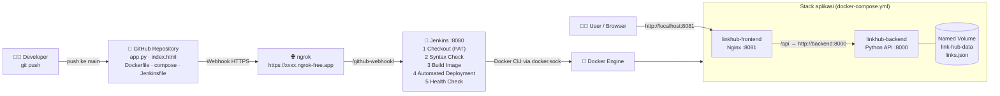

# 🔗 Resource Link Hub — Repositori Tautan Modul Praktikum

> **Ujian Chunin – Cloud Computing (Telkom University)**
> Cloud-Native Fullstack Application & Automated CI/CD Pipeline
> **Kelompok F** · Studi Kasus **No. 9 – Repositori Tautan Modul Praktikum (Resource Link Hub)**

Portal agregator tautan modul, slide, video, dan materi praktikum. Aplikasi terdiri dari
**Backend Python REST API** (data di **Docker Named Volume**) dan **Frontend HTML + Vanilla JS** di **Nginx**
(dengan **Bind Mount**). Keduanya terhubung lewat **Custom Bridge Network `app-net`**. Setiap `git push` ke `main` otomatis
di-deploy oleh **Jenkins** melalui **GitHub Webhook** (via **ngrok**).

---

## 👥 Anggota Kelompok F

| No | Nama                          | NIM            | Peran (saran)                       |
|----|-------------------------------|----------------|-------------------------------------|
| 1  | Gabriel Nathan Noel           | 101012300382   | Backend API & Docker Storage        |
| 2  | Ahmad Naufal Romadhon         | 101012300xxx   | Jenkins CI/CD, Webhook & ngrok      |
| 3  | Alexander Maximilliano Sirait | 101012300xxx   | Frontend, Nginx & Dokumentasi       |

> ⚠️ Lengkapi NIM yang masih `xxx` sebelum dikumpulkan.

---

## 🧭 Daftar Isi
1. [Arsitektur](#-arsitektur)
2. [Pemenuhan Spesifikasi](#-pemenuhan-spesifikasi-tugas)
3. [Struktur Repositori](#-struktur-repositori)
4. [Dokumentasi REST API](#-dokumentasi-rest-api)
5. [Menjalankan Secara Lokal](#-menjalankan-secara-lokal-windows--docker-desktop)
6. [Simulasi Data Immunity & Bind Mount](#-simulasi-data-immunity--bind-mount)
7. [Setup Jenkins CI/CD + GitHub Webhook + ngrok](#-setup-jenkins-cicd--github-webhook--ngrok)
8. [Penjelasan Jenkinsfile](#-penjelasan-jenkinsfile-5-stage)
9. [Troubleshooting](#-troubleshooting)
10. [Naskah Video Demo](#-naskah-video-demo-58-menit)

---

## 🏗 Arsitektur

### Alur CI/CD



### Arsitektur Docker (runtime)

```
Host: Windows + Docker Desktop
+--------------------------------------------------------------------------+
|  Browser -> http://localhost:8081            curl/Postman -> :8000       |
|                 |                                          |             |
|  +--------------|---- Custom Bridge Network: app-net ------|----------+  |
|  |              v                                          v          |  |
|  |  +-----------------------+   /api/* -> backend:8000  +-----------+ |  |
|  |  | linkhub-frontend      | ------------------------> | linkhub-  | |  |
|  |  | nginx:1.27-alpine     |    (DNS service name)     | backend   | |  |
|  |  | :80  -> host :8081    |                           | Python    | |  |
|  |  +-----------^-----------+                           | :8000     | |  |
|  |              |                                       +-----^-----+ |  |
|  +--------------|---------------------------------------------|-------+  |
|                 | Bind Mount (read-only)                      | Named    |
|                 |                                             | Volume   |
|   ./frontend/index.html                     link-hub-data:/var/lib/      |
|   ./nginx/default.conf                         backend_data/links.json   |
+--------------------------------------------------------------------------+
```

| Komponen | Image | Port Host | Storage | Network |
|---|---|---|---|---|
| `linkhub-backend` | `linkhub-backend:<build>` (Dockerfile sendiri) | `8000` | **Named Volume** `link-hub-data` → `/var/lib/backend_data/links.json` | `app-net` |
| `linkhub-frontend` | `nginx:1.27-alpine` | `8081` | **Bind Mount** `./frontend` → `/usr/share/nginx/html` | `app-net` |
| `jenkins` | `linkhub-jenkins:lts` (folder `jenkins/`) | `8080` | Named Volume `jenkins_home` | default |
| `ngrok` | `ngrok/ngrok` | `4040` (inspector) | – | default |

---

## ✅ Pemenuhan Spesifikasi Tugas

| Spesifikasi | Implementasi |
|---|---|
| Backend Python tanpa framework | `backend/app.py` hanya memakai standard library (`http.server`, `json`) |
| `GET /links`, `POST /links`, `DELETE /links?index=X` | ✔ + `GET /health` untuk health check |
| Error handling 400/404 presisi | 400 (JSON/field/index tidak valid), 404 (index/endpoint tidak ada), 405, 413, 415 |
| Data JSON di Named Volume | `links.json` di volume **`link-hub-data`** (`/var/lib/backend_data`), penulisan atomik & thread-safe |
| Frontend HTML + Vanilla JS + `fetch()` | `frontend/index.html`, tanpa framework, update real-time (tanpa reload) |
| Nginx + Bind Mount | `./frontend` di-bind-mount ke Nginx → edit HTML langsung terlihat tanpa rebuild |
| Custom Bridge Network `app-net` | Didefinisikan di `docker-compose.yml`, frontend memanggil backend via nama service `backend` |
| Seluruh stack deklaratif | `docker-compose.yml` |
| Jenkins + GitHub Webhook | `githubPush()` trigger, webhook lewat ngrok |
| Declarative Jenkinsfile 5 stage | Checkout · Syntax Check · Build Image · Automated Deployment · Health Check |
| GitHub PAT | Credential `github-pat` (Username with password) dipakai saat Checkout |

---

## 📁 Struktur Repositori

```
link-hub/
├── backend/
│   ├── app.py              # REST API (Python murni)
│   ├── Dockerfile          # Image backend
│   └── .dockerignore
├── frontend/
│   └── index.html          # UI (HTML + Vanilla JS, fetch API) → Bind Mount
├── nginx/
│   └── default.conf        # Nginx: static file + reverse proxy /api → backend:8000
├── jenkins/                # Jenkins siap pakai (opsional, untuk laptop kelompok)
│   ├── Dockerfile          # Jenkins LTS + Docker CLI + Compose + plugin
│   ├── plugins.txt
│   ├── casc/jenkins.yaml   # Konfigurasi otomatis (admin, credential PAT, job pipeline)
│   ├── docker-compose.yml  # Jenkins + ngrok
│   └── .env.example        # Template rahasia (salin ke .env, JANGAN di-commit)
├── docker-compose.yml      # Stack aplikasi (frontend + backend + volume + network)
├── Jenkinsfile             # Declarative Pipeline 5 stage
└── README.md
```

---

## 📡 Dokumentasi REST API

Base URL langsung: `http://localhost:8000` · lewat Nginx: `http://localhost:8081/api`

| Method | Endpoint | Deskripsi | Sukses | Error |
|---|---|---|---|---|
| `GET` | `/health` | Status layanan & storage | `200` | `503` jika storage tidak bisa ditulis |
| `GET` | `/links` | Daftar seluruh tautan | `200` | – |
| `POST` | `/links` | Tambah tautan (body JSON) | `201` | `400` JSON/field tidak valid, `413` terlalu besar, `415` bukan JSON |
| `DELETE` | `/links?index=X` | Hapus tautan pada index X | `200` | `400` index kosong/bukan angka/negatif, `404` index tidak ada |

**Body `POST /links`:**

```json
{
  "title": "Modul 3 - Docker Networking",
  "url": "https://example.com/modul-3.pdf",
  "category": "Modul",
  "description": "Materi custom bridge network"
}
```

- `title` (wajib, ≤120 karakter), `url` (wajib, `http://`/`https://` + domain valid)
- `category`: `Modul` | `Slide` | `Video` | `Repositori` | `Lainnya` (default `Lainnya`)
- `description` opsional (≤500 karakter)

**Contoh di PowerShell:**

```powershell
# GET
Invoke-RestMethod http://localhost:8000/links

# POST
Invoke-RestMethod -Method Post -Uri http://localhost:8000/links -ContentType 'application/json' `
  -Body '{"title":"Modul 1 - Docker","url":"https://docs.docker.com/get-started/","category":"Modul"}'

# DELETE index 0
Invoke-RestMethod -Method Delete -Uri "http://localhost:8000/links?index=0"

# Lihat respon error (400)
curl.exe -i -X DELETE "http://localhost:8000/links?index=abc"
```

**Contoh respon error:**

```json
{ "status": "error", "code": 404, "message": "Tautan dengan index 99 tidak ditemukan (total 3)." }
```

---

## 💻 Menjalankan Secara Lokal (Windows + Docker Desktop)

**Prasyarat:** Docker Desktop (WSL2 backend) sudah berjalan, Git terpasang.

```powershell
git clone https://github.com/<username>/<nama-repo>.git
cd <nama-repo>

docker compose up -d --build
docker compose ps
```

| Akses | URL |
|---|---|
| UI Frontend | http://localhost:8081 |
| API langsung | http://localhost:8000/links |
| API via Nginx | http://localhost:8081/api/links |
| Health check | http://localhost:8000/health |

Cek komponen Docker:

```powershell
docker network inspect app-net      # kedua kontainer ada di custom bridge network
docker volume inspect link-hub-data # named volume backend
docker exec linkhub-frontend wget -qO- http://backend:8000/health   # DNS service name
```

Menghentikan stack (**tanpa `-v`** agar data tetap ada):

```powershell
docker compose down
```

---

## 🛡 Simulasi Data Immunity & Bind Mount

### 1. Data Immunity (Named Volume)

```powershell
# a. Tambah beberapa tautan lewat UI http://localhost:8081, lalu cek:
Invoke-RestMethod http://localhost:8000/links | Select-Object count

# b. Hancurkan kontainer backend secara paksa
docker rm -f linkhub-backend
docker ps -a                          # backend hilang, UI menampilkan "API tidak terjangkau"

# c. Buat ulang kontainer backend
docker compose up -d backend

# d. Data masih utuh 🎉
Invoke-RestMethod http://localhost:8000/links | Select-Object count

# e. Bukti data tersimpan di volume
docker run --rm -v link-hub-data:/data alpine cat /data/links.json
```

> Data hanya hilang bila volume dihapus dengan sengaja (`docker compose down -v` atau `docker volume rm link-hub-data`).

### 2. Bind Mount (Frontend)

1. Buka http://localhost:8081.
2. Edit `frontend/index.html`, misalnya ubah teks `Tambah Tautan Materi`, lalu simpan.
3. Refresh browser, dan perubahan langsung tampil **tanpa rebuild image dan tanpa restart kontainer**.

---

## ⚙️ Setup Jenkins CI/CD + GitHub Webhook + ngrok

Folder `jenkins/` berisi Jenkins yang **sudah dikonfigurasi otomatis**:
- Plugin sudah terpasang dan setup wizard dilewati.
- User admin, credential **GitHub PAT** (`github-pat`), dan job pipeline **`linkhub-pipeline`** dibuat otomatis lewat *Jenkins Configuration as Code*.
- ngrok berjalan sebagai kontainer, sehingga tidak perlu menginstal ngrok di Windows.

### Langkah 1 — Buat GitHub Personal Access Token (PAT)
1. GitHub → foto profil → **Settings** → **Developer settings**.
2. **Personal access tokens** → **Tokens (classic)** → **Generate new token (classic)**.
3. **Note:** `Jenkins CI/CD UTS Token`, **Expiration:** 30 atau 90 hari.
4. Centang scope **`repo`** dan **`admin:repo_hook`**.
5. **Generate token**, lalu salin token `ghp_xxxx...` (hanya tampil sekali).

### Langkah 2 — Siapkan akun ngrok
1. Daftar di https://dashboard.ngrok.com (gratis).
2. Salin **Authtoken** dari menu *Your Authtoken*.
3. Disarankan: buka **Domains** dan klaim **domain statis gratis** (misalnya `nama-kalian.ngrok-free.app`), supaya URL webhook tidak berubah setiap restart.

### Langkah 3 — Isi konfigurasi `.env`

```powershell
cd jenkins
copy .env.example .env
notepad .env
```

Isi nilainya:

```ini
JENKINS_ADMIN_ID=admin
JENKINS_ADMIN_PASSWORD=passwordKuat123
GITHUB_USERNAME=username-github
GITHUB_PAT=ghp_xxxxxxxxxxxxxxxxxxxx
REPO_URL=https://github.com/username-github/nama-repo.git
NGROK_AUTHTOKEN=2abcXYZ...
NGROK_URL=nama-kalian.ngrok-free.app
JENKINS_PUBLIC_URL=https://nama-kalian.ngrok-free.app/
```

> 🔒 `jenkins/.env` sudah ada di `.gitignore` dan **tidak boleh** di-push ke GitHub.

### Langkah 4 — Jalankan Jenkins + ngrok

```powershell
docker compose up -d --build     # build pertama ± 3–5 menit
docker compose logs -f jenkins   # tunggu "Jenkins is fully up and running", lalu Ctrl+C
```

- Jenkins: http://localhost:8080 (login sesuai `.env`)
- URL publik ngrok: http://localhost:4040, atau `docker logs ngrok`

Job **`linkhub-pipeline`** sudah otomatis ada:
- Pipeline script from SCM
- Repo dari `REPO_URL`
- Credential `github-pat`
- Branch `*/main`
- Trigger *GitHub hook trigger for GITScm polling*

### Langkah 5 — Build pertama (manual)
Buka job **linkhub-pipeline** lalu klik **Build Now**. Pastikan kelima stage hijau. Build pertama juga mendaftarkan trigger webhook dari `Jenkinsfile`.

### Langkah 6 — Pasang GitHub Webhook
1. Repo GitHub → **Settings** → **Webhooks** → **Add webhook**.
2. **Payload URL:** `https://nama-kalian.ngrok-free.app/github-webhook/`. Garis miring `/` di akhir **wajib**.
3. **Content type:** `application/json`.
4. **Which events:** *Just the push event*.
5. **Add webhook**. Centang hijau ✔ di *Recent Deliveries* berarti webhook berhasil.

### Langkah 7 — Uji auto-deploy 🚀

```powershell
# di folder repo (bukan folder jenkins)
notepad frontend\index.html      # ubah sesuatu
git add .
git commit -m "feat: ubah judul UI"
git push origin main
```

Jenkins akan otomatis memulai build baru tanpa klik **Build Now**. Setelah selesai, buka http://localhost:8081, maka perubahan sudah ter-deploy. Badge di kanan atas menampilkan nomor build backend (`build #N`).

### Alternatif: Jenkins yang sudah terpasang manual
Kalau Jenkins sudah terpasang sendiri, buat job **Pipeline** dengan pengaturan berikut:
- *Pipeline script from SCM* → Git.
- URL repo, credential **Username with password** (username GitHub + PAT).
- Branch `*/main`, Script Path `Jenkinsfile`.
- Centang **GitHub hook trigger for GITScm polling**.

Agent Jenkins harus punya Docker CLI + Docker Compose dan akses ke Docker daemon.

---

## 🧩 Penjelasan Jenkinsfile (5 Stage)

| # | Stage | Yang dilakukan |
|---|---|---|
| 1 | **Checkout** | `checkout scm` memakai credential **`github-pat`**, lalu menampilkan commit terbaru |
| 2 | **Syntax Check** | Cek file wajib, `py_compile` / `ast.parse` untuk `app.py`, `docker compose config` untuk validasi compose, dan cek `fetch()` di `index.html` |
| 3 | **Build Image** | `docker build` → `linkhub-backend:<BUILD_NUMBER>` + `:latest` (berisi label commit) |
| 4 | **Automated Deployment** | Stop kontainer lama dengan `docker compose down` **tanpa `-v`** (volume aman), lalu `docker compose up -d` dengan image baru |
| 5 | **Health Check** | Dari dalam kontainer frontend: `GET http://backend:8000/health` (dengan retry), `GET /api/links` lewat proxy Nginx, dan memastikan `index.html` tersaji |

**Catatan teknis (Docker Desktop):** Jenkins berjalan di dalam kontainer dan memakai Docker milik host
(*Docker-outside-of-Docker*). Path `$WORKSPACE` hanya ada di dalam kontainer Jenkins, sehingga stage Deploy
menerjemahkannya ke path asli di host (`docker inspect` → sumber mount `jenkins_home`) dan mengirimkannya sebagai
`HOST_PROJECT_DIR` ke `docker-compose.yml`. Dengan begitu bind mount frontend tetap menunjuk ke file hasil checkout terbaru.

`post { failure }` menampilkan log kontainer bila build gagal, dan `post { always }` membersihkan image lama (menyisakan 3 build terakhir).

---

## 🩺 Troubleshooting

| Masalah | Solusi |
|---|---|
| `port is already allocated` (8000/8080/8081) | Matikan aplikasi yang memakai port tersebut, atau ubah port host di `docker-compose.yml` |
| Webhook GitHub merah (4xx/5xx) | Pastikan URL diakhiri `/github-webhook/`, ngrok jalan (`docker logs ngrok`), dan Content type `application/json` |
| Push tidak memicu build | Jalankan **Build Now** sekali dulu, lalu cek job → *Configure* → *GitHub hook trigger for GITScm polling* tercentang |
| URL ngrok berubah | Pakai domain statis gratis (`NGROK_URL`), atau perbarui Payload URL di GitHub Webhook |
| Checkout gagal `Authentication failed` | PAT salah atau kedaluwarsa. Perbarui `GITHUB_PAT` di `.env` lalu jalankan `docker compose up -d`, atau ubah credential `github-pat` di *Manage Jenkins → Credentials* |
| `permission denied ... docker.sock` | Pastikan service Jenkins memakai `user: root` (sudah di compose) dan Docker Desktop berjalan |
| Health Check gagal "index.html tidak tersaji" | Bind mount salah path. Cek log stage Deploy, baris `Bind mount frontend dari host: ...` |
| UI "API tidak terjangkau" | `docker compose ps`, lalu `docker logs linkhub-backend` |
| Reset total data (hati-hati!) | `docker compose down -v` |

---

## 🎬 Naskah Video Demo (5–8 Menit)

| Menit | Pembicara | Adegan |
|---|---|---|
| 0:00–0:45 | Anggota 1 | Perkenalan kelompok F, studi kasus Resource Link Hub, tampilkan diagram arsitektur di README |
| 0:45–2:00 | Anggota 1 | Penjelasan `app.py` dan demo API di PowerShell: GET, POST, DELETE, serta error 400/404 |
| 2:00–3:00 | Anggota 3 | Demo UI: tambah tautan, filter, cari, hapus (real-time). Tunjukkan Bind Mount: edit `index.html`, refresh langsung berubah |
| 3:00–4:15 | Anggota 1 | **Data Immunity**: `docker rm -f linkhub-backend` → UI offline → `docker compose up -d backend` → data masih ada, lalu `docker volume inspect link-hub-data` |
| 4:15–5:00 | Anggota 2 | Tunjukkan `docker network inspect app-net`, Jenkinsfile 5 stage, credential PAT, dan webhook di GitHub (ngrok) |
| 5:00–7:00 | Anggota 2 | **CI/CD**: ubah UI (misalnya judul), lakukan `git commit` + `git push`, Jenkins otomatis ter-trigger, tampilkan *Stage View* hijau, lalu refresh UI dan perubahan tampil dengan badge `build #N` |
| 7:00–7:45 | Anggota 3 | Penutup: ringkasan dan pembagian tugas |

---

<sub>Kelompok F · Cloud Computing · Telkom University</sub>
